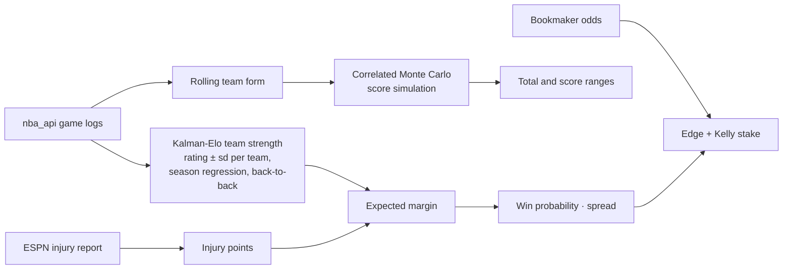

<p align="center">
  
</p>

<p align="center">
  <a href="docs/HUONG_DAN.md">🇻🇳 Hướng dẫn tiếng Việt</a>
</p>

<p align="center">
  <a href="https://github.com/bigboybigbet/nba_app_quant/actions/workflows/ci.yml"></a>
  
  
</p>

NBA Quant predicts every NBA game before tip-off: the home team's win probability, the expected margin, and the expected total, with Monte Carlo ranges around both. It runs locally, pulls game logs from the official stats API, adjusts for injuries from the ESPN report, and compares its numbers with bookmaker odds to flag value.

The model rates every team in points above average, with an uncertainty band, using a Kalman filter: each result moves a team's rating by an amount that depends on how sure the model already was, ratings regress 20% toward average each summer, and the second night of a back-to-back costs a point. The expected margin becomes a win probability through a logistic curve fitted on the last three seasons.

It runs as a local web app (FastAPI + HTML, no build step, works offline). Every modelling change is judged on the same yardstick: a walk-forward backtest over seven held-out seasons (8,874 real games) in which the model only ever sees games played before the one it predicts.

## What it does

- Predicts a single matchup or scans a full day's slate, with win probability, spread, total and confidence
- Rates every team in points with a Kalman-filter Elo that updates after every game, with an uncertainty band
- Adjusts both teams for injured players, weighted by status (out, doubtful, questionable, day-to-day)
- Simulates 50,000 correlated score pairs per game for spread and total ranges
- Converts bookmaker moneylines to implied probabilities and sizes stakes with a fractional Kelly criterion
- Back-tests any date range blind, then learns its blend weights from the results
- Keeps a prediction and bet history with ROI tracking, and can push picks to Telegram

## How a prediction is made



Each training row is one game seen from the home side: home-minus-away differences in Elo, net rating over 5 and 15 games, the Four Factors (effective FG%, turnover rate, offensive rebound rate, free-throw rate), pace, recent win rate, rest and back-to-backs. Every rolling statistic is shifted one game, so a game's own result never reaches its features, and a test in `tests/` checks exactly that.

## Benchmark

`research/benchmark.py` trains on three seasons, freezes the model, and predicts the next season game by game, for every season from 2017-18 to 2023-24. Lower log loss is better; a coin flip scores 0.693.

| Model | Log loss | Accuracy |
|---|---:|---:|
| **Kalman-Elo team strength, v6 (current)** | **0.628** | **64.5%** |
| Margin-of-victory Elo | 0.634 | 64.0% |
| Gradient-boosted model, v5 | 0.652 | 62.6% |

v6 beats the plain Elo rating by 0.005 log loss per game (standard error 0.001) and the v5 gradient-boosted model by 0.024; the tree model overfit its rolling features. Opponent-adjusted ridge ratings scored the same as v6 (0.628), and stacking several team ratings added nothing measurable because they are 98% correlated. Standings incentives (tanking, resting, seeding) are real but added only 0.0008 on top of the ratings, below the significance bar, so they are not in the model. Reproduce the table with:

```bash
git clone --depth 1 https://github.com/NocturneBear/NBA-Data-2010-2024 ../nba-data-2010-2024
NBA_HISTORY_DIR=../nba-data-2010-2024 python -m research.benchmark --variants v5,elo,elo_plus --reference elo
```

## Getting started

### 1. Requirements

- Python 3.11 or newer (`python --version`)
- Git
- A normal home or office internet connection. NBA.com's stats API often blocks cloud servers and some VPNs; if downloads time out, switch the VPN off.

### 2. Install

```bash
git clone https://github.com/bigboybigbet/nba_app_quant.git
cd nba_app_quant
python -m venv .venv
```

Activate the virtual environment:

| System | Command |
|---|---|
| macOS / Linux | `source .venv/bin/activate` |
| Windows PowerShell | `.venv\Scripts\Activate.ps1` (if blocked: `Set-ExecutionPolicy -Scope CurrentUser RemoteSigned`) |
| Windows cmd | `.venv\Scripts\activate.bat` |

Then install the dependencies:

```bash
pip install -r requirements.txt
```

### 3. Start the app

```bash
python -m server
```

The browser opens http://127.0.0.1:8000. Options: `--port 8010` if 8000 is taken, `--no-browser` to skip opening a tab. Stop it with `Ctrl+C`.

### 4. Build the model (first run, then about once a week)

1. Open the **Model** page.
2. Tick **Force full rebuild** and press **Train**.
3. Wait for the progress bar (a few minutes). The app downloads the 2023-24 to 2026-27 seasons, replays the team ratings through every game into `team_strength.json`, and trains the reference models.

Until this has run once, predictions fall back to plain Elo. Seasons roll forward automatically each October.

### 5. Predict a game

Open **Game**, pick the home and away teams, and the app shows the win probability, expected margin (spread), total, the team ratings with their uncertainty, injuries from the ESPN report, and a breakdown of the probability into rating gap, home court, back-to-back and injuries. Enter bookmaker moneylines (or set an Odds API key) to see the edge and a capped Kelly stake.

To keep the ratings current during the season, press **Grade new games** on the Model page after games finish: it grades the new results and rebuilds the ratings.

### 6. Optional keys

On the **Settings** page, or in a `.env` file copied from `.env.example`:

| Key | What for |
|---|---|
| `ODDS_API_KEY` | Live moneylines from [The Odds API](https://the-odds-api.com) (free tier: 500 requests a month). Without it, ESPN odds are used when available. |
| `TELEGRAM_BOT_TOKEN`, `TELEGRAM_CHAT_ID` | Send picks to a Telegram chat. |

Keys stay in `.env` on your machine (gitignored); the app never sends them to the browser.

### 7. Try it offline (demo mode)

Replay any date from 2010-11 to 2023-24 with real historical games, no network needed:

```bash
git clone --depth 1 https://github.com/NocturneBear/NBA-Data-2010-2024 ../nba-data-2010-2024
NBA_HISTORY_DIR=../nba-data-2010-2024 NBA_QUANT_DEMO_DATE=2024-03-15 python -m server
```

On Windows PowerShell set the variables first: `$env:NBA_HISTORY_DIR="..\nba-data-2010-2024"; $env:NBA_QUANT_DEMO_DATE="2024-03-15"`.

### The previous interface

The Streamlit app still works and uses the same model: `streamlit run nba_app.py`. The Slate, Accuracy, Bets and Ratings pages of the web app are still being built, so use Streamlit for scanning a full day, range backtests and the ROI log until then.

### Troubleshooting

| Problem | Fix |
|---|---|
| Train fails with a timeout on stats.nba.com | Turn off VPN / proxy and retry; NBA.com rate-limits, so wait a minute between attempts. |
| `Address already in use` | `python -m server --port 8010` |
| Predictions say "Elo only" | Run **Train** once (step 4). |
| Injuries show "unavailable" | ESPN's feed was unreachable; the prediction is made without injuries and says so. |
| `ModuleNotFoundError` | The virtual environment is not active; activate it (step 2) and reinstall. |

## Project layout

```
server/                  FastAPI web app (python -m server): API, background jobs, demo mode
web/                     HTML pages, CSS, JS; libraries vendored for offline use
engine/
  team_strength.py       Kalman-Elo team ratings → margin → win probability (current model)
  models.py              dataset builder, prediction entry point, v5 reference model
  features.py            live pre-game team form
  simulate.py            correlated Monte Carlo for totals and score ranges
  betting.py             odds conversion and Kelly sizing
data/
  injuries.py            ESPN injury report and player impact
  autobacktest.py        grades finished games and refreshes the ratings
  elo.py, odds.py, schedule.py, cache.py
research/
  benchmark.py           walk-forward benchmark on 2010-24 games
  variants/              every model tried, with its benchmark code
tests/                   offline tests (pytest)
nba_app.py               previous Streamlit interface
config.py                constants and season roll-over
```

## Development

```bash
pip install pytest httpx
python -m pytest -q
```

A new model idea goes into `research/variants/<name>.py` (see the docstring in `research/benchmark.py`), is tuned on the 2014-15 to 2016-17 seasons only, and is scored once on the held-out seasons. Pull requests that change the model should paste that output.

## Data and disclaimer

Game and player statistics come from NBA.com through [`nba_api`](https://github.com/swar/nba_api); injuries, schedules and scores from ESPN's public endpoints; historical research data from [NocturneBear/NBA-Data-2010-2024](https://github.com/NocturneBear/NBA-Data-2010-2024). This project is not affiliated with the NBA, ESPN or any bookmaker. Forecasts are probabilities, not guarantees. Nothing here is betting advice; if you bet, only stake what you can afford to lose.
