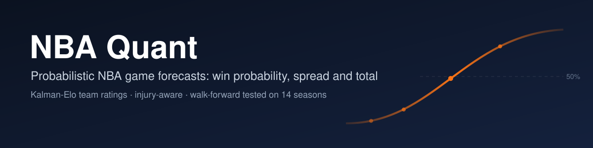
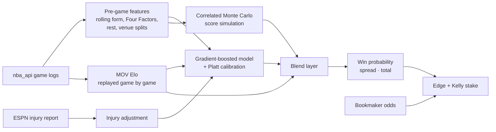

<p align="center">
  
</p>

<p align="center">
  <a href="https://github.com/bigboybigbet/nba_app_quant/actions/workflows/ci.yml"></a>
  
  
</p>

NBA Quant predicts every NBA game before tip-off: the home team's win probability, the expected margin, and the expected total, with Monte Carlo ranges around both. It runs locally, pulls game logs from the official stats API, adjusts for injuries from the ESPN report, and compares its numbers with bookmaker odds to flag value.

Every modelling change is judged on the same yardstick: a walk-forward backtest over seven held-out seasons (8,874 real games) in which the model only ever sees games played before the one it predicts.

## What it does

- Predicts a single matchup or scans a full day's slate, with win probability, spread, total and confidence
- Tracks team strength with a margin-of-victory Elo rating that updates after every game
- Adjusts both teams for injured players, weighted by status (out, doubtful, questionable, day-to-day)
- Simulates 50,000 correlated score pairs per game for spread and total ranges
- Converts bookmaker moneylines to implied probabilities and sizes stakes with a fractional Kelly criterion
- Back-tests any date range blind, then learns its blend weights from the results
- Keeps a prediction and bet history with ROI tracking, and can push picks to Telegram

## How a prediction is made



Each training row is one game seen from the home side: home-minus-away differences in Elo, net rating over 5 and 15 games, the Four Factors (effective FG%, turnover rate, offensive rebound rate, free-throw rate), pace, recent win rate, rest and back-to-backs. Every rolling statistic is shifted one game, so a game's own result never reaches its features, and a test in `tests/` checks exactly that.

## Benchmark

`research/benchmark.py` trains on three seasons, freezes the model, and predicts the next season game by game, for every season from 2017-18 to 2023-24. Lower log loss is better; a coin flip scores 0.693.

| Model | Log loss | Brier | Accuracy |
|---|---:|---:|---:|
| Margin-of-victory Elo | 0.634 | 0.221 | 64.0% |
| Gradient-boosted model, v5 | 0.652 | 0.230 | 62.6% |

The plain Elo rating beats the v5 gradient-boosted model by 0.019 log loss per game (standard error 0.003): with these features the tree model overfits. The next model version replaces it with team and player rating systems combined by a stacked ensemble, and only components that beat this table on the held-out seasons will ship. Reproduce the table with:

```bash
git clone --depth 1 https://github.com/NocturneBear/NBA-Data-2010-2024 ../nba-data-2010-2024
NBA_HISTORY_DIR=../nba-data-2010-2024 python -m research.benchmark --variants v5,elo
```

## Quick start

```bash
git clone https://github.com/bigboybigbet/nba_app_quant.git
cd nba_app_quant
python -m venv .venv && source .venv/bin/activate      # Windows: .venv\Scripts\activate
pip install -r requirements.txt
streamlit run nba_app.py
```

On first launch, press **Train / Reload Model** with *Force full rebuild*. The app downloads the 2024-25, 2025-26 and current 2026-27 seasons, replays Elo through every game, and trains the model (a few minutes). Training seasons roll forward automatically each October.

Optional keys, entered in the app's settings tab and kept only in memory for the session: a [The Odds API](https://the-odds-api.com) key for live moneylines, and a Telegram bot token and chat ID for pushing picks.

## Project layout

```
nba_app.py               Streamlit interface
config.py                constants, feature list, season roll-over
engine/
  models.py              dataset builder, training, calibration, blend layer
  features.py            live pre-game features for one team
  simulate.py            correlated Monte Carlo and quarter projections
  betting.py             odds conversion and Kelly sizing
data/
  elo.py                 margin-of-victory Elo
  injuries.py            ESPN injury report and player impact
  autobacktest.py        blind back-test of newly finished games
  odds.py, schedule.py   bookmaker odds, schedule and scores
  cache.py               SQLite cache for API responses
research/
  benchmark.py           walk-forward benchmark on 2010-24 games
  variants/              experimental models scored by the benchmark
tests/                   offline tests (pytest)
player_impact_updater.py builds player_impact.json from season stats
optuna_tuner.py          optional hyperparameter search
```

## Development

```bash
pip install pytest
python -m pytest -q
```

A new model idea goes into `research/variants/<name>.py` (see the docstring in `research/benchmark.py`), is tuned on the 2014-15 to 2016-17 seasons only, and is scored once on the held-out seasons. Pull requests that change the model should paste that output.

## Data and disclaimer

Game and player statistics come from NBA.com through [`nba_api`](https://github.com/swar/nba_api); injuries, schedules and scores from ESPN's public endpoints; historical research data from [NocturneBear/NBA-Data-2010-2024](https://github.com/NocturneBear/NBA-Data-2010-2024). This project is not affiliated with the NBA, ESPN or any bookmaker. Forecasts are probabilities, not guarantees. Nothing here is betting advice; if you bet, only stake what you can afford to lose.
